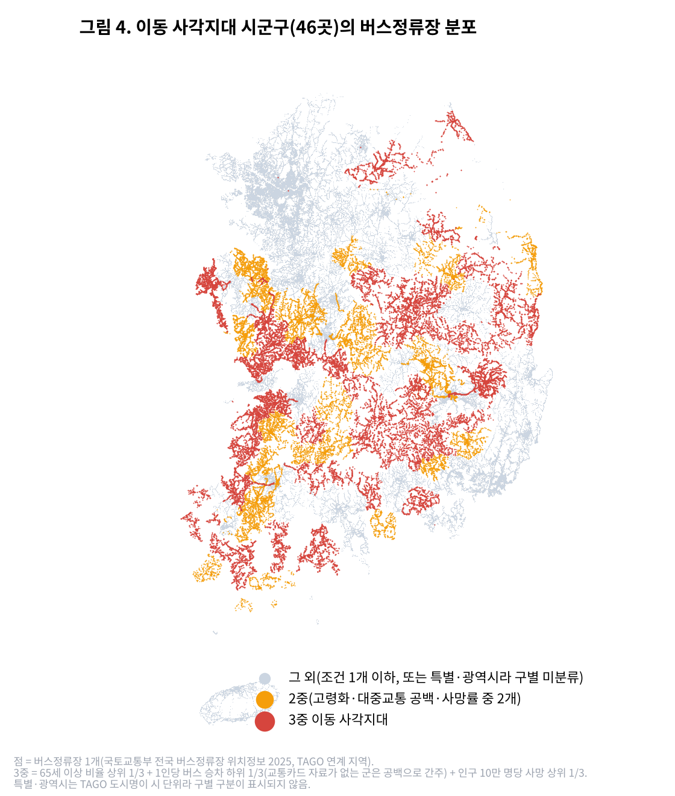

# 운전대를 놓은 노인은 어디로 가는가

나이 든 운전자가 운전면허를 스스로 반납하고 나면 무엇을 타고 다닐까요?
버스가 거의 없는 동네라면 병원도, 시장도 가기 어려워집니다.
이 저장소는 **공공데이터로 그런 동네가 어디인지 찾고, 어떤 도움이 필요한지 제안한** 분석의 코드와 자료입니다.

- 공모전: 「AI와 함께하는 교통문제 해결을 위한 데이터 분석 공모전」
- 팀: 안전 면허 (김민규)
- 분석보고서: [`report/안전 면허_분석보고서.pdf`](report/안전%20면허_분석보고서.pdf)

---

## 이 분석이 답하려는 질문

1. 버스가 적은 지역은 면허 반납도 적을까?
2. **노인이 많고, 버스는 거의 안 다니고, 교통사고로 숨지는 사람이 많은 지역**은 어디이고 몇 곳일까?
3. 면허를 반납한 노인이 계속 이동할 수 있으려면 무엇이 필요할까?

---

## 알아낸 것

### 1. 교통사고로 숨진 사람의 절반 이상이 65세 이상이에요

2025년 교통사고 사망자 2,549명 중 1,378명(54.1%)이 65세 이상이었어요.
65세 이상은 인구의 20.6%뿐인데도요. 인구 수를 감안하면 65세 미만보다 **4.5배** 많이 숨졌어요.

### 2. 나이 든 운전자가 낸 사고의 비중이 10년 만에 거의 두 배가 됐어요

교통사고 사망자 가운데 65세 이상 운전자가 낸 사고로 숨진 사람의 비중이 17.6%(2015년)에서 33.1%(2025년)로 늘었어요.

### 3. 면허 반납은 81배 늘었지만, 지역마다 2배 가까이 차이 나요

- 65세 이상 면허 반납: 1,415건(2015년) → 114,436건(2024년)
- 65세 이상 1,000명당 반납(2024년): 부산 14.4건(가장 많음), 전남 7.3건(가장 적음)
- 시도별로 보면 **버스를 많이 타는 지역일수록 반납도 많았어요.** (두 순위가 함께 움직이는 정도 ρ = 0.70, 1에 가까울수록 강함)

### 4. 버스를 가장 적게 타는 지역은 교통사고 사망률이 5.8배 높아요

전국 시군구를 1인당 버스 승차 횟수로 줄 세워 5묶음으로 나눴어요.
가장 적게 타는 20%는 인구 10만 명당 15.9명이 교통사고로 숨졌어요.
가장 많이 타는 20%는 2.7명이었어요.

### 5. 나이 든 운전자의 사고는 횟수는 비슷한데, 숨지는 사람은 5.7배예요

| 버스 이용 | 65세 이상 1,000명당 사고 | 65세 이상 10만 명당 사망 |
| --- | --- | --- |
| 가장 적은 20% | 4.21건 | 21.15명 |
| 가장 많은 20% | 4.17건 | 3.73명 |

### 6. '이동 사각지대' 46곳을 찾았어요

아래 세 조건에 모두 해당하는 시군구예요.

- 노인 비율이 높은 편이다 (상위 1/3)
- 버스를 적게 탄다 (하위 1/3)
- 교통사고 사망률이 높은 편이다 (상위 1/3)

이 46곳에는 전국 인구의 **4.1%**만 살지만, 전국 교통사고 사망자의 **16.5%**가 이곳에서 나왔어요.
46곳 중 41곳이 군 지역이고, 경북(12곳)·전남(10곳)·경남(8곳)·충남(6곳)에 많아요.



### 7. 반납률 1위 부산: 지하철은 노인을 받쳐 주지만, 부족한 곳도 있어요

- 부산 지하철 승객 중 무료(경로 등) 승차 비중: 25.8%(2014년) → 34.1%(2024년)
- 부산은 65세 이상 10만 명당 고령운전자 사고 사망자가 3.15명으로 전국(7.62명)의 절반도 안 돼요. 17개 시도 중 가장 낮아요.
- 지하철이 닿지 않는 곳은 사정이 달라요. 교통약자 전용 차량 '두리발'은 한 달(2025년 5월) 동안 37,194번 호출됐어요. 그중 **9.4%는 차를 배정받지 못했고**, 대기 시간은 중간값 42분이었어요.
- 노인 보행자 사고가 잦은 곳으로 지정된 기록(2023~2025년) 781건 중 129건이 부산이에요. 부산의 노인 인구는 전국의 7.6%인데 말이에요.

---

## 그래서 제안하는 것

1. **반납하면 이동을 보장하기:** 반납 혜택을 일회성 교통카드 대신, 부르면 오는 버스(DRT)나 공공 택시 이용권으로 바꿔요.
2. **'이동 사각지대 지수'로 예산 나누기:** 이번에 쓴 지표로 매년 순위를 다시 매겨 버스 지원 순서를 정해요.
3. **걷는 길도 안전하게:** 반납한 노인은 보행자가 되니까, 정류장·경로당 주변을 노인보호구역으로 먼저 지정해요.

자세한 내용과 기대효과는 [분석보고서](report/안전%20면허_분석보고서.pdf)에 있어요.

---

## 폴더 안내

| 폴더 | 들어 있는 것 |
| --- | --- |
| `analysis/` | 분석 코드 4개. 번호 순서대로 실행해요 |
| `data/raw/` | 공공데이터 원본(내려받은 그대로) |
| `data/raw_api/` | KOSIS OpenAPI로 받은 원본 |
| `data/processed/` | 원본을 시군구 227곳 × 지표 표로 정리한 것 |
| `outputs/` | 결과 그림(`figures/`), 표(`tables/`), 핵심 숫자(`results.json`) |
| `outputs_file2026/` | 비교용 결과(2026년 9월 인구로 계산한 처음 방식) |
| `report/` | 보고서 PDF와 PDF를 만드는 코드 |
| `collect/` | 자료 수집 스크립트(rdhub 도구가 있어야 실행됨, 분석만 다시 할 때는 필요 없음) |
| `logs/` | AI가 수집 도구를 호출한 기록 |

---

## 직접 돌려 보기

Python 3.13에서 만들었어요. 아래 순서대로 실행하면 보고서와 **같은 숫자**가 나와요(예: 이동 사각지대 46곳).

**1) 필요한 패키지 설치**

```bash
pip install -r requirements.txt
```

**2) 원본 자료를 시군구별 표로 정리** → `data/processed/`

```bash
python analysis/01_build_panel.py
```

**3) 분석하고 그림 1~4 만들기** → `outputs/`

```bash
python analysis/02_analysis.py
```

**4) 비교용: 처음 방식(2026년 9월 인구)으로 한 번 더 계산** → `outputs_file2026/`

```bash
POP_SOURCE=file2026 python analysis/01_build_panel.py
POP_SOURCE=file2026 python analysis/02_analysis.py
```

Windows PowerShell에서는 먼저 `$env:POP_SOURCE="file2026"`을 입력한 뒤 두 줄을 실행하고, 끝나면 `Remove-Item Env:POP_SOURCE`로 지워요.

**5) 숫자 검증: 처음 방식과 API 자료로 다시 계산한 결과를 비교** → `outputs/verification.json`

```bash
python analysis/03_verify.py
```

**6) 부산 사례와 그림 5** → `outputs/results_busan.json`

```bash
python analysis/04_busan_case.py
```

**7) 공모전 양식 보고서 PDF 만들기** → `report/안전 면허_분석보고서.pdf`

```bash
python -m playwright install chromium
python report/build_report_form.py
```

보고서의 숫자는 사람이 손으로 옮겨 적지 않고, 코드가 `outputs/results.json`에서 읽어 자동으로 채워요.

---

## 사용한 데이터 (16종)

| 알려 주는 것 | 자료 이름 | 만든 곳 | 링크 |
| --- | --- | --- | --- |
| 시군구별 교통사고·사망자 | 시도 시군구별 교통사고 통계(2025) | 한국도로교통공단 | [공공데이터포털](https://www.data.go.kr/data/15070297/fileData.do) |
| 나이대별 사망자 | 사상자 연령층별 성별 교통사고 통계(2025) | 한국도로교통공단 | [공공데이터포털](https://www.data.go.kr/data/15070293/fileData.do) |
| 노인 교통사고(보조 자료) | 부문별 노인 교통사고 통계(2018) | 한국도로교통공단 | [공공데이터포털](https://www.data.go.kr/data/15094162/fileData.do) |
| 시군구별 고령운전자 사고 | 지자체별 대상 교통사고 통계(2024·2025, OpenAPI) | 한국도로교통공단 | [공공데이터포털](https://www.data.go.kr/data/15056770/openapi.do) |
| 노인 보행자 사고가 잦은 곳 | 보행노인 교통사고 다발지역(2023~2025, OpenAPI) | 한국도로교통공단 | [공공데이터포털](https://www.data.go.kr/data/15057666/openapi.do) |
| 시도별 면허 반납 | 시도 경찰청별 고령운전자 자진반납 현황(2015~2024) | 경찰청 | [공공데이터포털](https://www.data.go.kr/data/15065567/fileData.do) |
| 나이 든 운전자 사고 추이 | 가해자 연령층별 교통사고(2015~2025, OpenAPI) | 경찰청 | [KOSIS](https://kosis.kr/statHtml/statHtml.do?orgId=132&tblId=DT_V_MOTA_021) |
| 시군구별·나이별 인구 | 주민등록인구(2024.6·2025.6, OpenAPI) | 행정안전부 | [KOSIS](https://kosis.kr/statHtml/statHtml.do?orgId=101&tblId=DT_1B04006) |
| 비교용 인구 | 지역별(행정동) 성별 연령별 주민등록 인구수(2026.9.30) | 행정안전부 | [공공데이터포털](https://www.data.go.kr/data/15097972/fileData.do) |
| 앞으로의 노인 인구 | 성 및 연령별 추계인구(중위) | 통계청 | [KOSIS](https://kosis.kr/statHtml/statHtml.do?orgId=101&tblId=DT_1BPA001) |
| 버스를 얼마나 타나 | 시군구별 정류장평균이용량(2025) | 국토교통부 | [공공데이터포털](https://www.data.go.kr/data/15162142/fileData.do) |
| 버스정류장 위치(지도) | 전국 버스정류장 위치정보(2025) | 국토교통부 | [공공데이터포털](https://www.data.go.kr/data/15067528/fileData.do) |
| 자동차를 얼마나 타나 | 용도별 차종별 시군구별 일평균 자동차 주행거리(2019) | 한국교통안전공단 | [공공데이터포털](https://www.data.go.kr/data/15088483/fileData.do) |
| 부산 지하철 무료 승차 | 부산도시철도 월별 역별 권종별 승하차(2014~2024) | 부산교통공사 | [부산 Big-데이터웨이브](https://data.busan.go.kr/bdip/opendata/detail.do?publicdatapk=15128561) |
| 부산 교통약자 차량(두리발) | 부산 교통약자 이동지원 차량 운영현황(2025.5) | 부산시설공단 | [부산 Big-데이터웨이브](https://data.busan.go.kr/bdip/opendata/detail.do?publicdatapk=15147515) |
| 부산 노인보호구역 위치 | 전국 노인·장애인 보호구역 표준데이터(부산) | 부산 각 구군 | [부산 Big-데이터웨이브](https://data.busan.go.kr/bdip/opendata/detail.do?publicdatapk=15034532) |

**써도 되는 자료인지 확인했어요.**

- 공공데이터포털 파일: 내려받을 때 페이지에 적힌 재배포 조건을 `data/raw/sources.csv`에 기록했어요.
- OpenAPI 2종과 부산 자료 3종: 이용허락범위가 '제한 없음'인 것을 확인해 `data/raw/license_check_20261021.json`에 남겼어요(2026년 10월 21일).
- 원본 파일을 어디서 받았는지(원래 주소)와 파일 지문(SHA-256)은 `data/raw/index.json`, `data/raw/koroad_api/index.json`, `data/raw/busan_bigdatawave/index.json`에 적어 두었어요.
- 개인정보가 담긴 자료는 쓰지 않았어요.

---

## AI를 어떻게 썼나

- **자료 찾기·내려받기:** 직접 만든 자료 수집 도구 **rdhub**를 AI(Claude)가 불러서 썼어요. 자료 검색 → 원문 페이지에서 제공기관·이용 조건 확인 → 파일 내려받기 → 파일 지문 기록 → 표 정리 순서예요. 도구를 부른 기록은 모두 `logs/`에 있어요.
- **코드와 보고서 초안:** Claude가 함께 썼어요.
- **숫자는 코드가 채워요:** AI가 숫자를 기억으로 적지 못하도록, 보고서의 숫자는 모두 분석 결과 파일에서 자동으로 가져와요.
- **다시 계산해서 확인했어요:** 처음에는 2026년 9월 인구로 계산했어요. 이후 사고·반납이 일어난 해의 6월 인구를 KOSIS OpenAPI로 받아 전부 다시 계산했고, 결론은 그대로였어요. 비교표는 `outputs/tables/table_verification.csv`에 있어요.

---

## 주의할 점

- **원인과 결과를 증명한 것은 아니에요.** 시군구 단위로 함께 나타나는 경향을 본 것이에요.
- **자료의 연도가 조금씩 달라요.** 사고·반납과 인구는 같은 해로 맞췄지만, 자동차 주행거리는 2019년 자료예요.
- **'고령운전자 사고 사망자'에는 그 사고로 숨진 모든 사람이 들어가요.** 운전자 본인뿐 아니라 상대 차량 탑승자, 보행자도 포함돼요.
- **버스 이용은 교통카드 기록만 셌어요.** 현금 승차와 부르면 오는 버스(DRT)는 빠져 있어요.
- **부산 자료에는 빈 곳이 있어요.** 두리발은 교통약자를 위한 한 달치 기록이고, 노인보호구역 자료는 16개 구군 중 11곳만 있어요.
- **이산화탄소 감축량은 가정을 넣어 계산한 값이에요.** 계산 방법은 보고서에 있어요.
